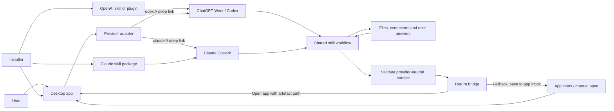

# Sk-app technical overview

## Summary

A **sk-app** is a skill-backed application: a small, purpose-built GUI wrapped around a reusable AI skill.

The AI harness handles the ambiguous work — finding context, asking questions, reasoning, drafting and validation. The desktop application handles the precise live interaction — opening, reviewing, controlling or playing back the finished result. The user's existing ChatGPT or Claude account supplies the AI surface, so the app does not need to embed a model, recreate a chat interface or collect an API key.

In one line:

> A sk-app gives a skill a focused GUI and gives an ordinary user a product instead of a prompt.

Cued is the reference implementation: its skill prepares a speaking-card deck in ChatGPT Work or Claude Cowork, while its Windows app provides a low-friction playback surface.

## Definition of done

A build qualifies as a working sk-app when:

- one installer puts the desktop app and its support files in a user-selected location;
- the app can start the intended ChatGPT and Claude work surfaces with useful task context;
- each provider runs the same underlying workflow and produces the same provider-neutral output contract;
- the completed output can be handed back to the desktop app without copying content by hand;
- the app validates the output before using it;
- a supported fallback remains when automatic return is unavailable;
- installation, first use, upgrade and removal have been tested on a clean user account; and
- no provider credentials or sensitive source material are placed in deep-link URLs or bundled in the app.

## What a sk-app is — and is not

| A sk-app is | A sk-app is not |
| --- | --- |
| A focused GUI for the result of a skill workflow | A generic chat window around an API |
| A conventional local app plus provider adapters | A desktop app made entirely out of prompts |
| A versioned contract between reasoning and interface | Screen scraping or copying prose from a conversation |
| User-triggered use of an authenticated desktop harness | An unattended way to inject work into a user's private account |
| Provider-neutral at the job and result level | Identical implementation inside ChatGPT and Claude |

The useful abstraction is **equivalent outcomes, not identical provider mechanics**. ChatGPT and Claude should accept the same job and return the same type of result even when their launch, skill installation and tool surfaces differ.

## Reference architecture



The architecture has seven separable parts:

1. **Desktop app** — owns the specialised user experience and runtime state.
2. **Shared domain contract** — defines the job, output and validation rules.
3. **Skill** — owns the repeatable reasoning workflow.
4. **Provider adapters** — translate a job into supported ChatGPT and Claude launch links.
5. **Return bridge** — gives the completed artefact back to the app.
6. **Installer and updater** — install the app, skill packages, shortcuts and schemas.
7. **Diagnostics** — record enough local, non-sensitive information to explain failed hand-offs.

Keep these parts independent. Provider URL formats should not leak into the GUI, and provider-specific instructions should not leak into the output schema.

## The two-way communication model

“Two-way” does not have to mean a permanently open socket or a live chat embedded in the app. The smallest reliable pattern is **command out, artefact back**.

### Outbound leg: app to harness

1. The user chooses a provider in the app.
2. The app creates a small job envelope and a writable job folder.
3. A provider adapter builds a deep link containing a short, URL-encoded bootstrap prompt and, where supported, the absolute job-folder path.
4. The operating system opens the provider's desktop app.
5. The provider pre-fills the composer. The user reviews and sends the task.
6. The installed skill takes over, gathers context and runs its own human-in-the-loop workflow.

The prompt should carry only routing information: the skill name, action, job ID, working folder and expected result. Large context belongs in files or connectors, not in the URL.

### Return leg: harness to app

1. The skill writes the result to the agreed job folder.
2. It validates the result against the shared schema.
3. If the harness has authorised local desktop or shell control, it launches the app with the result path.
4. Otherwise it returns the file to the user and leaves it in the app's inbox folder.
5. The app validates the result again before opening it.

The app, not the model, is the final authority on whether an artefact is safe and structurally usable.

### Integration levels

| Level | Pattern | Use when | Trade-off |
| --- | --- | --- | --- |
| 1 | Deep link out; validated file back | First release and consumer distribution | Most portable; one user send action remains |
| 2 | Deep link out; local tool or MCP callback back | The harness can call a registered local tool | Cleaner return and richer status; more installation and security work |
| 3 | Managed bidirectional agent connection | Building a provider-specific, deeply integrated product | Full streaming and lifecycle control; no longer a thin, provider-neutral desktop hand-off |

For OpenAI-specific deep integration, Codex App Server exposes bidirectional JSON-RPC and is intended for rich clients requiring authentication, history, approvals and streamed agent events. The Codex SDK is the higher-level automation route. These are useful extensions, but they are not required for the basic sk-app pattern and should not be presented as equivalent Claude Cowork capabilities.

## Canonical job and result contracts

The job contract is the stable seam between the GUI and each provider adapter. A minimal job envelope might be:

```json
{
  "schemaVersion": 1,
  "jobId": "01JZ...",
  "skill": "make-example-output",
  "action": "create",
  "createdAt": "2026-07-17T10:30:00Z",
  "workspace": "C:\\Users\\Sam\\ExampleApp\\Jobs\\01JZ...",
  "inputPaths": [
    "inputs\\brief.docx"
  ],
  "result": {
    "schema": "example-output.schema.json",
    "path": "result.example.json"
  },
  "return": {
    "application": "C:\\Users\\Sam\\ExampleApp\\ExampleApp.exe",
    "arguments": ["--open", "{resultPath}"]
  }
}
```

The corresponding status/result envelope might be:

```json
{
  "schemaVersion": 1,
  "jobId": "01JZ...",
  "status": "complete",
  "artifactPath": "C:\\Users\\Sam\\ExampleApp\\Jobs\\01JZ...\\result.example.json",
  "warnings": [],
  "completedAt": "2026-07-17T10:42:00Z"
}
```

Contract rules:

- use a unique, non-guess-derived job ID;
- version jobs, results and domain artefacts independently;
- use absolute paths only at the machine boundary and relative paths inside a job folder where possible;
- write to a temporary filename, validate, then rename atomically;
- make completion idempotent so a repeated callback does not duplicate work;
- keep `status` values finite, for example `created`, `in_progress`, `needs_user`, `complete`, `failed` and `cancelled`;
- put human-readable detail in `warnings` or a log, not in fields the app must parse; and
- never treat conversational prose as the machine contract.

## Deep-link adapters

Provider links are a bootstrap mechanism. They open the correct desktop surface and prefill the composer; they are not a durable message queue, authentication protocol or automatic submission channel.

### Current supported routes

As of 17 July 2026:

| Provider | New work link | Useful parameters | Important boundary |
| --- | --- | --- | --- |
| ChatGPT desktop / Codex | `codex://threads/new?` or `codex://new?` | `prompt`, `path`, `originUrl` | Prefills but does not send. No documented link parameter forces Work mode or a model. `path` must be an absolute local directory. |
| Claude Cowork | `claude://cowork/new` | `q`, plus repeatable `folder` and `file` parameters | Prefills the composer. Folder attachments are treated as untrusted and require user confirmation. Prompt text is truncated at roughly 14,000 characters. |

ChatGPT can also prefill a prompt that mentions an installed plugin. If the plugin is available but not installed, ChatGPT may offer the user an install-and-continue flow. That is useful for distribution, but the user still controls installation and sending.

### Adapter interface

Keep link construction behind a small interface:

```text
ProviderAdapter
  IsAvailable() -> capability result
  BuildLaunchUri(job) -> URI
  DescribeManualFallback(job) -> user instruction
```

Adapter rules:

- URL-encode every query value with the platform's URI-component encoder;
- keep the bootstrap prompt short and put substantial context in the working folder;
- do not place secrets, tokens, private document contents or personally sensitive data in a URL;
- validate that every supplied path exists and is within an allowed app or user-selected location;
- test spaces, apostrophes, ampersands, Unicode and long Windows paths;
- detect a missing protocol handler and explain which desktop app is required;
- never claim the prompt was submitted when it was only prefilled; and
- keep link formats and capability flags in one place so provider changes are cheap to update.

## Skill design

The shared skill should describe the domain workflow, not the visual mechanics of the app or the quirks of one provider.

It should define:

- when it should and should not trigger;
- which local files, attached folders or connectors to inspect first;
- what the skill must confirm with the user;
- which gaps to ask about, preferably one at a time;
- when the user must approve a plan or running order;
- the exact domain schema and validation command;
- where to save the result;
- how to attempt the return hand-off; and
- the manual fallback when the app cannot be launched.

Package thin provider-specific wrappers only where necessary. The core instructions, examples, schema and validator should remain the same so that a ChatGPT result and a Claude result are interchangeable.

The skill should fail closed on installation. An attached ZIP is not necessarily an installed or enabled skill; if the harness has not loaded it as a skill, it should tell the user how to install it rather than silently imitating the workflow from a loose instruction file.

## Installation and distribution

### Suggested Windows package

```text
SkApp-release/
├── SkAppSetup.exe
├── app/
│   ├── SkApp.exe
│   └── schemas/
├── skills/
│   ├── source/<skill-name>/
│   └── <skill-name>-claude.zip
├── openai-marketplace/
├── packages/
└── README.md
```

### Installer responsibilities

The installer should:

1. default to a visible per-user folder such as `%USERPROFILE%\SkApp` and allow the user to change it;
2. copy the app, schemas and provider packages without requiring administrator rights where possible;
3. create the app's `Jobs`, `Inbox` or output folder;
4. offer Desktop and Start-menu shortcuts with the app's own icon;
5. install the OpenAI user skill to `%USERPROFILE%\.agents\skills\<skill-name>` when the user opts in;
6. keep the Claude skill ZIP available and guide the user through the required upload/enable step;
7. optionally open a first-run provider prompt and the desktop app after setup;
8. make reinstall safe and preserve user-created artefacts; and
9. write an uninstall entry or provide an explicit removal procedure.

### OpenAI installation

For a single Windows user, a local installer can copy a skill into `$HOME/.agents/skills`. Codex discovers user skills there; a restart may be needed if a change does not appear.

For wider ChatGPT Work distribution, package the skill as an OpenAI plugin. Plugins are the documented distribution format for reusable skills and optional connectors across Work mode and Codex. A plugin deep link can open its install flow when the marketplace is known. Treat local skill copying as the simple personal-install route and a plugin as the managed distribution route.

### Claude installation

The documented personal installation path is user-controlled:

1. package the skill folder as a ZIP with the skill folder at its root;
2. open **Customize → Skills → + Create skill → Upload a skill**;
3. upload the ZIP; and
4. enable the skill.

There is no documented Claude desktop deep link that silently installs a personal skill. Do not disguise that consent boundary with brittle UI automation. The installer can reveal the ZIP and open clear instructions. Team and Enterprise owners can provision skills organisation-wide, and supported skill sharing can remove repeated manual distribution inside an organisation.

### Upgrade strategy

- Give the app, skill and schema independent semantic versions.
- Include the supported schema range in both the app and skill.
- Overwrite application binaries, but preserve jobs, outputs and user settings.
- Keep provider packages inspectable and show their version in diagnostics.
- On schema mismatch, refuse to open the artefact and give a specific upgrade route.
- Code-sign public Windows releases when the project moves beyond trusted beta testers.

## The GUI-for-skills principle

The GUI exists because some interactions are better as software than as conversation.

Use the harness for:

- finding and synthesising context;
- resolving ambiguity;
- asking adaptive questions;
- planning and drafting;
- applying judgement; and
- producing a validated result.

Use the GUI for:

- fast, repeated or live controls;
- spatial layout and glanceability;
- keyboard, pointer and accessibility behaviour;
- deterministic state transitions;
- opening and managing finished artefacts; and
- interactions where another chat turn would be friction.

Do not rebuild the provider inside the app. In most sk-apps the clean product boundary is:

```text
Prepare in the harness → use the result in the app → return to the harness only for a meaningful revision
```

This keeps the app narrow and lets the skill use the provider's existing connectors, files, permissions and conversational context.

## Security and trust boundaries

A sk-app joins three trust zones: the local application, the AI harness and the user's source material. Treat every crossing explicitly.

- **Deep links are visible input.** Do not put secrets or sensitive content in them.
- **Attached and connected content is untrusted.** The skill must resist instructions embedded in source material that try to override its workflow or exfiltrate data.
- **Local paths are capabilities.** Restrict writes to a user-selected or app-owned folder and reject traversal outside it.
- **Artefacts are untrusted until validated.** Parse with safe limits; reject unknown schema versions and unexpectedly large files.
- **Launching processes is privileged.** Use a fixed executable and argument pattern, never a model-authored shell command.
- **Skills are executable supply-chain material.** Show provenance, version them and let users inspect what is installed.
- **Provider permissions remain provider-controlled.** The app must not imply that a deep link bypasses folder confirmation, skill enablement or tool approval.
- **Logs should be useful but sparse.** Record job ID, provider, timestamps, paths and error categories; avoid recording source text or prompt contents by default.

## Common failure modes

| Symptom | Likely cause | Required behaviour |
| --- | --- | --- |
| Provider button does nothing | Desktop app or protocol handler missing | Show the required app and a manual copyable prompt |
| Provider opens but task does not start | Deep links prefill rather than send | Tell the user to review and send; do not label it as a timeout without evidence |
| Wrong ChatGPT mode or model | Deep link cannot force either | Request the preferred surface in the prompt, but keep the skill compatible with other capable models |
| Claude asks to confirm the folder | Expected Cowork security behaviour | Explain once; do not attempt to bypass it |
| Harness ignores the skill | Skill missing, disabled, stale or poorly described | Check installation and enablement; make the prompt explicitly invoke the skill |
| Result is written but app does not open | Local desktop control unavailable or denied | Leave the validated file in the app inbox and show its path |
| App rejects the result | Schema mismatch or invalid output | Preserve the file, show the validation error and offer regeneration or upgrade |
| Old result opens for a new task | Reused path or missing job correlation | Require matching job IDs and unique job folders |
| Duplicate windows or outputs appear | Repeated callback | Make open/complete operations idempotent |
| Deep link breaks on another machine | Bad escaping, long prompt or hard-coded path | Encode centrally, minimise the URL and test clean-machine paths |

## Build playbook

### 1. Choose one narrow live job

Write the app's one-sentence job. If the proposed GUI includes general chat, open-ended editing, several unrelated workflows or a provider settings console, the scope is probably too broad for the first sk-app.

### 2. Define the output contract first

Specify the domain artefact, schema, validation rules, maximum sizes and compatibility policy before writing the skill or GUI. Build one valid and several deliberately invalid fixtures.

### 3. Storyboard the hand-off

Show every user-visible step from install to first successful return. Mark which actions are automatic, which require provider confirmation and which are fallbacks. Do not hide a required click behind language such as “seamless”.

### 4. Write the provider-neutral skill

Implement the context search, confirmation, questions, plan gate, creation, validation and delivery workflow. Test it manually in both providers before adding deep links.

### 5. Add thin provider adapters

Build and test the supported deep links from the same job envelope. Keep provider-specific prompt additions short and observable.

### 6. Implement the return bridge

Start with validated file output plus an app launch attempt. Add a watched inbox or local callback only when it materially removes friction and can be secured.

### 7. Build the GUI around the artefact

The app should work perfectly with a manually opened valid artefact. Provider integration is an entry route, not a prerequisite for its core runtime.

### 8. Package installation and removal

Test default and custom locations, reinstall, shortcut creation, skill updates, no-admin accounts and preservation of user data.

### 9. Verify the complete matrix

Test the shipped files, not development copies.

## Verification matrix

Minimum release checks:

| Area | Cases |
| --- | --- |
| Windows install | Clean account; default path; custom path; spaces and Unicode; reinstall; uninstall |
| App | Manual valid artefact; invalid JSON; wrong schema; oversized content; keyboard and accessibility path |
| ChatGPT | App closed/open; skill installed/missing; prompt prefill; user send; requested Work hand-off; successful return; file-only fallback |
| Claude | App closed/open; skill uploaded/disabled; Cowork link; folder confirmation; successful return; file-only fallback |
| Contracts | Matching and mismatched job IDs; duplicate completion; atomic write interruption; old and new supported schemas |
| Failure recovery | Missing protocol handler; denied folder; denied desktop control; unwritable output folder; provider offline |
| Package truth | Hash release files; inspect ZIP roots; confirm shortcuts and icons; compare installed skill to packaged source |

For every case, record the expected visible behaviour, actual result, build hash and any remaining manual step. Separate an engineering pass from a frictionless-user-journey pass.

## Cued as the reference implementation

Cued currently demonstrates the Level 1 pattern:

- a playback-only Windows GUI;
- one provider-neutral `.cued.json` deck contract;
- a shared `make-cued-deck` workflow;
- provider-specific `codex://` and `claude://cowork/new` launch adapters;
- local OpenAI skill installation and a Claude upload ZIP;
- skill-side validation; and
- an attempted `Cued.exe <deck-path>` return with a file fallback.

Its deliberate limitation is also instructive: it does not embed chat, generate cards itself or pretend a prefilled deep link is an automatically executed job. That narrowness is the pattern to preserve in other sk-app builds.

## Recommended next extraction

This document can become a `build-sk-app` skill. The skill should interview the builder one question at a time, produce the domain contract and storyboard before code, choose the lowest sufficient integration level, scaffold provider adapters and generate the verification matrix. It should not default to building an API wrapper or assume parity between ChatGPT Work and Claude Cowork.

## Official references

- [OpenAI: ChatGPT desktop commands and deep links](https://learn.chatgpt.com/docs/reference/commands)
- [OpenAI: Build skills](https://learn.chatgpt.com/docs/build-skills)
- [OpenAI: Build plugins](https://learn.chatgpt.com/docs/build-plugins)
- [OpenAI: Codex App Server](https://learn.chatgpt.com/docs/app-server)
- [OpenAI: Codex SDK](https://learn.chatgpt.com/docs/codex-sdk)
- [Anthropic: Open Claude Desktop with a link](https://support.claude.com/en/articles/14729294-open-claude-desktop-with-a-link)
- [Anthropic: How to create custom skills](https://support.claude.com/en/articles/12512198-how-to-create-custom-skills)
- [Anthropic: Use skills in Claude](https://support.claude.com/en/articles/12512180-use-skills-in-claude)
